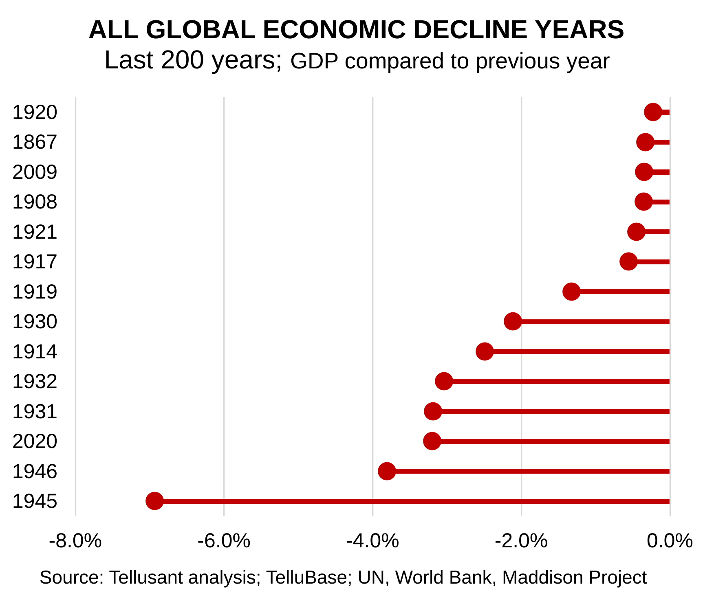

# Global Recessions Since 1820
<a href="{{ site.company.url }}" target="_blank" style="color: black; text-decoration: none;"><i>By {{ site.company.name }}</i></a>  | *2026-10-30*

<a href="https://tellubase.com"  target="_blank" >Here is an example of how TelluBase can be used:</a> We took a two-centuries view to see which years have seen the worst economic performance globally.

Global GDP has declined 14 times in a single year. The pandemic year 2020 is the third worst. The previous drop was in 1946.

Country recessions are rarer today than 50, 100, 150 or 200 years ago. Looking at the graph, this is not obvious. The 1800s had few global recessions. The reason is synchronicity. Way back, countries did not move in synchronously, today they tend to do this.

Still, only one major global recession since World War II is quite an achievement and something to be celebrated.

