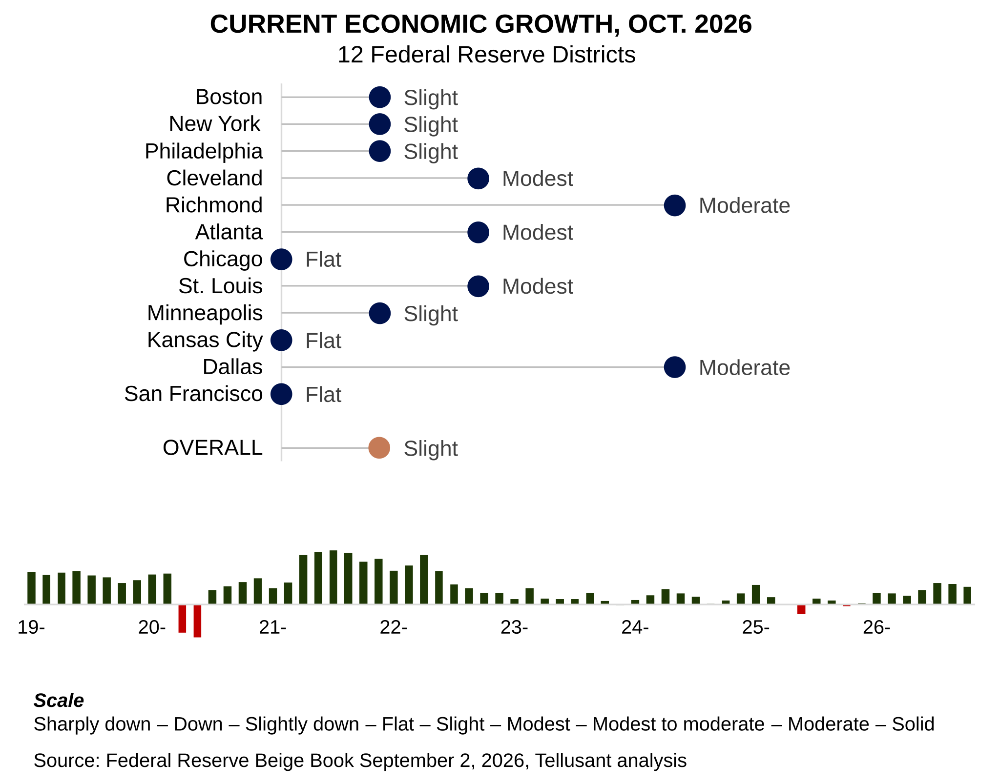
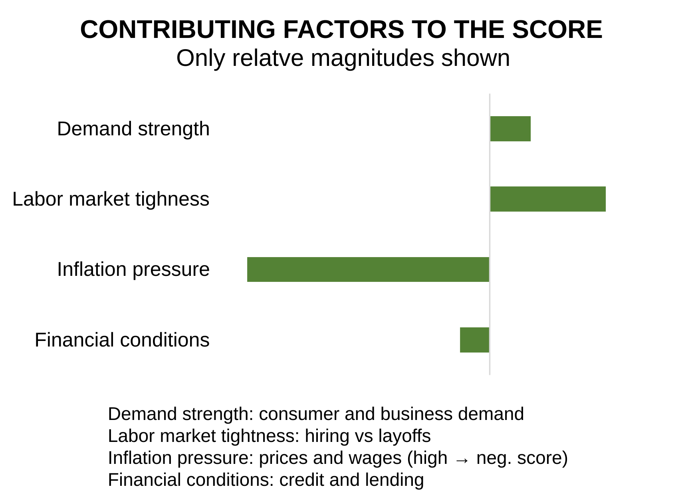
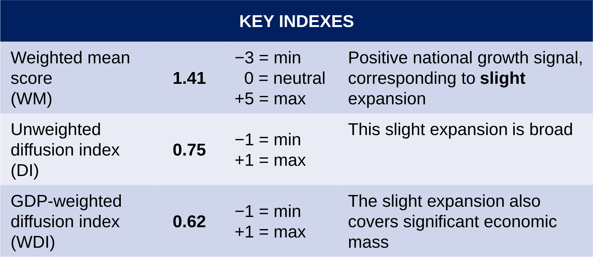

<a href="background.html">Find the background to Tellusant's Beige Book nowcast here</a>

# Beige Book Nowcast: Sentiment Analysis of U.S. Economic Activity — October 14, 2026

U.S. Economic activity increased slightly in the October Beige Book period, with conditions improving across 10 of 12 districts. National performance was lower than in the September Beige Book, resulting in slight instead of modest growth.

  

Underlying conditions point to continued support from labor tightness, but market demand is now weak. Persistent price pressures remain a major constraint on overall economic momentum.

The GDP-weighted growth index is 1.42 which signals slight growth and down from from 1.62 (modest growth) in the September Beige Book. Both unweighted and weighted diffusion measures are stable meaning that the slight expansion expansion is broad based bth b district, and by district econoic mass (GDP).

---
#### [Archive](beige-book-archive.md)

#### [Retrospective Comparison of Fed Beige Book Nowcast and Actual GDP Growth](beige-book-retrospective.md)  
