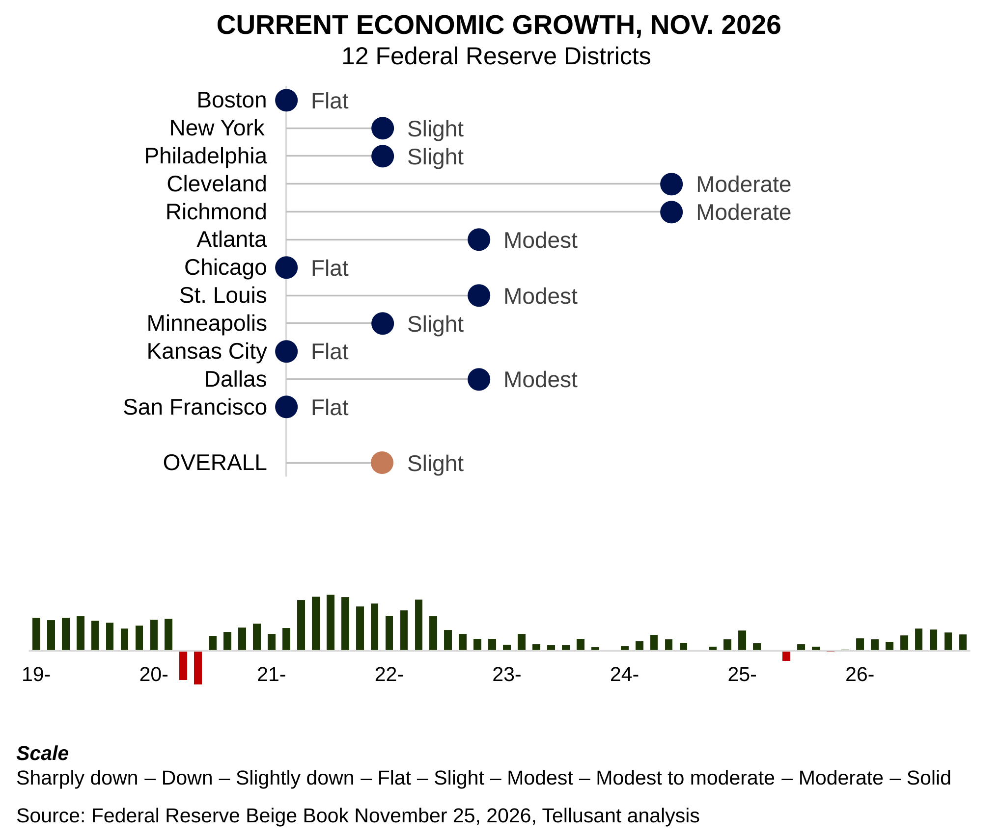
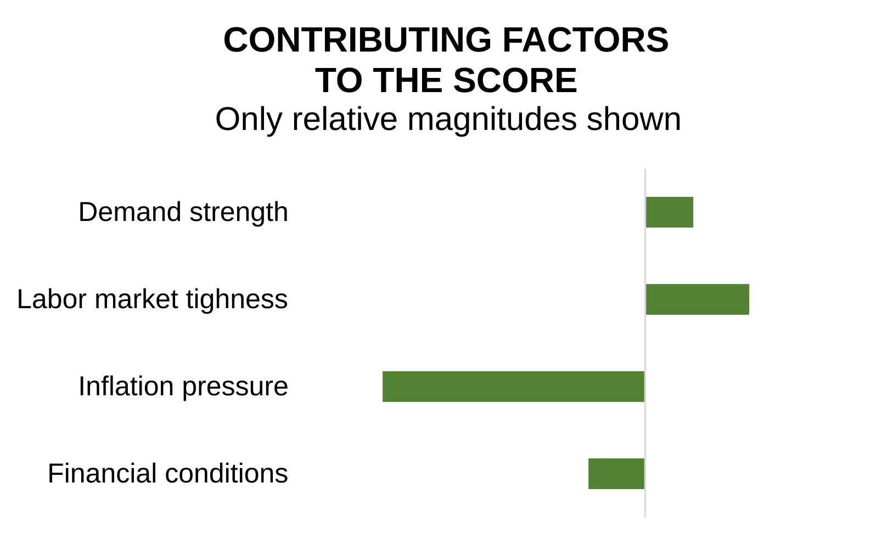
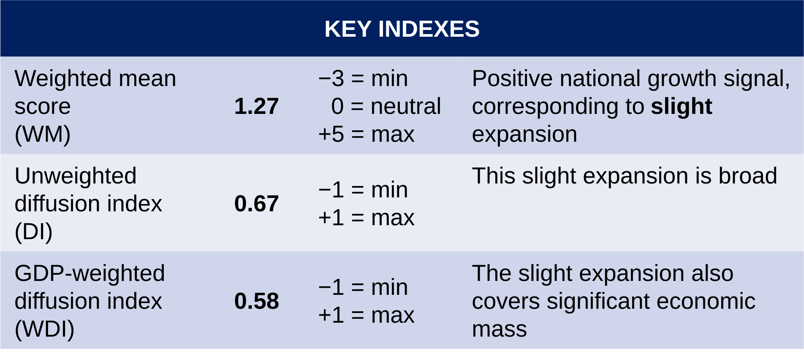

<a href="background.md">Find the background to Tellusant's Beige Book nowcast here</a>

# Beige Book Nowcast: Sentiment Analysis of U.S. Economic Activity
 <a href="{{ site.company.url }}" target="_blank" style="color: black; text-decoration: none;"><i>By {{ site.company.name }}</i></a>  | *2026-11-25*
 
The Fed's Beige Book, Summary of Commentary on Current Economic Conditions, covers current economic activity for the 12 Federal Reserve Districts. Tellusant converts it into a quantitative nowcast using our ***Fedora*** agent.

---
## November 25, 2026
U.S. Economic activity was slightly down in the November Beige Book period compared to the previous period. Conditions improved in 9 of 12 districts (from 10/12). National performance was lower than in the October Beige Book.

  

Underlying conditions point to continued support from labor tightness, but market demand is weak. Persistent price pressures remain a major constraint on overall economic momentum.

The GDP-weighted growth index is 1.27 which signals *slight* growth, down from from 1.41 in the October Beige Book. Both unweighted and weighted diffusion measures are stable, with slight expansion by district (DI) and by district economic mass (WDI).

---
#### [Archive](beige-book-archive.md)

#### [Retrospective Comparison of Fed Beige Book Nowcast and Actual GDP Growth](beige-book-retrospective.md)  
