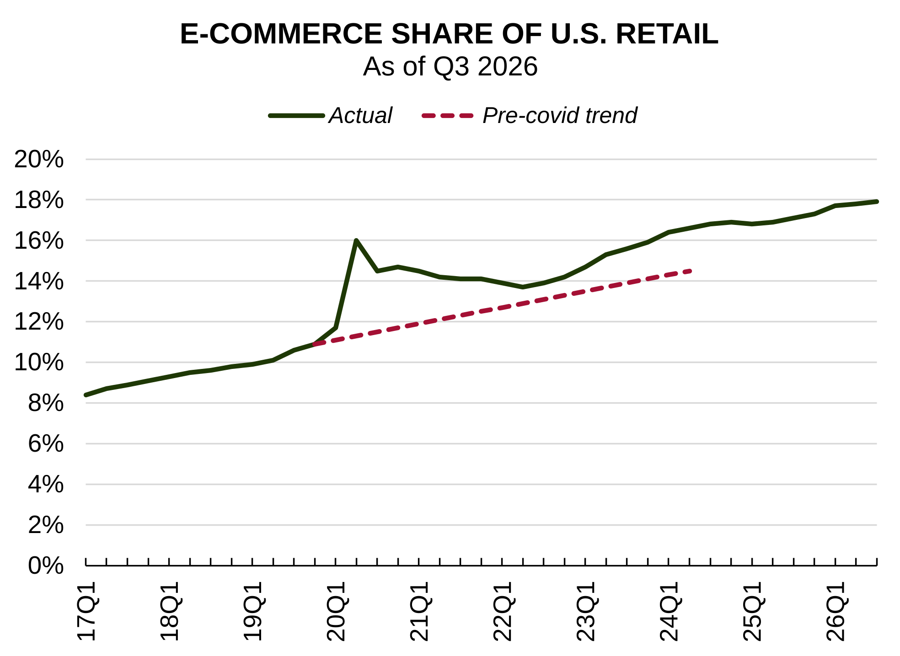

# U.S. E-commerce Trends as of Q3 2026

<a href="https://tellusant.com" style="color: black; text-decoration: none;">
  <i>By Tellusant, Inc.</i>
</a> 

E-commerce continuous to grow and the second quarter follows the steady-state trend. No surprises in this quarter.

This steady increase continues to put pressure on traditional retail. In just 5 years, e-commerce has grown more than 6 percentage points (relative to covid-cleansed trend). A staggering number. Quarterly year-on-year growth is well above GDP growth.

What we see is a version of boiling the frog. Each increment may not look like much, but combined the change is massive.

---

---
These analyses were previously published on Tellusant's LinkedIn page and can be found [there](https://www.linkedin.com/company/tellusant/).
