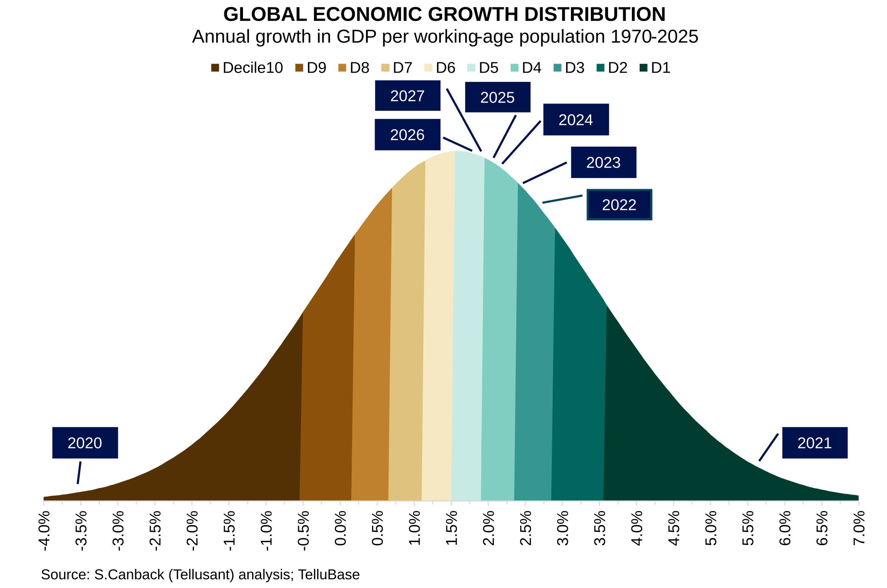
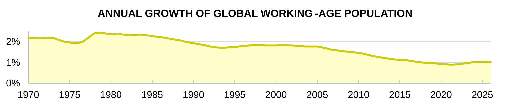

# Global Economic Growth in 2026 and 2027
<a href="{{ site.related_sites.canback.url }}" target="_blank" style="color: black; text-decoration: none;"><i>By {{ site.related_sites.canback.name }}</i></a>, <a href="{{ site.company.url }}" target="_blank" style="color: black; text-decoration: none;"><i>{{ site.company.name }}</i></a>
  | *2026-10-21*

How is the world economy performing in 2026? And what can we expect in 2027? IMF's World Economic Outlook (WEO) was recently released and we use it to assess performance by year from 1970 till 2027, illustrated with a Gauss curve.  

The graph shows that the 2026 growth is expected to be above average despite wars and tariffs. 2027 may be slightly higher. The 202os have been above average in all years except the 2020 pandemic year.

  

We measure economic performance as growth in GDP per working-age population, in line with serious authorities. The graph below shows that what many think of as an economic decline is in fact a demographic decline. Around 1 percentage point decline in annual growth is due to demographic headwinds since the 1980s.

  

The same analysis is available for regions and countries (from 1970), and cities (from 2000) based on TelluBase.

<a href="https://tellubase.com"  target="_blank" >The same analysis is available for regions and countries (from 1970), and cities (from 2000) based on <b>TelluBase</b> data</a>
